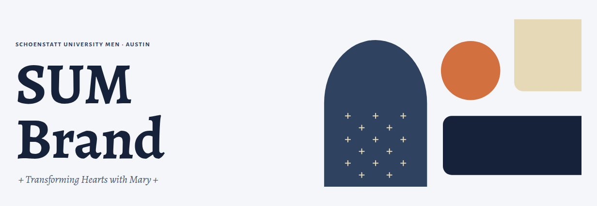
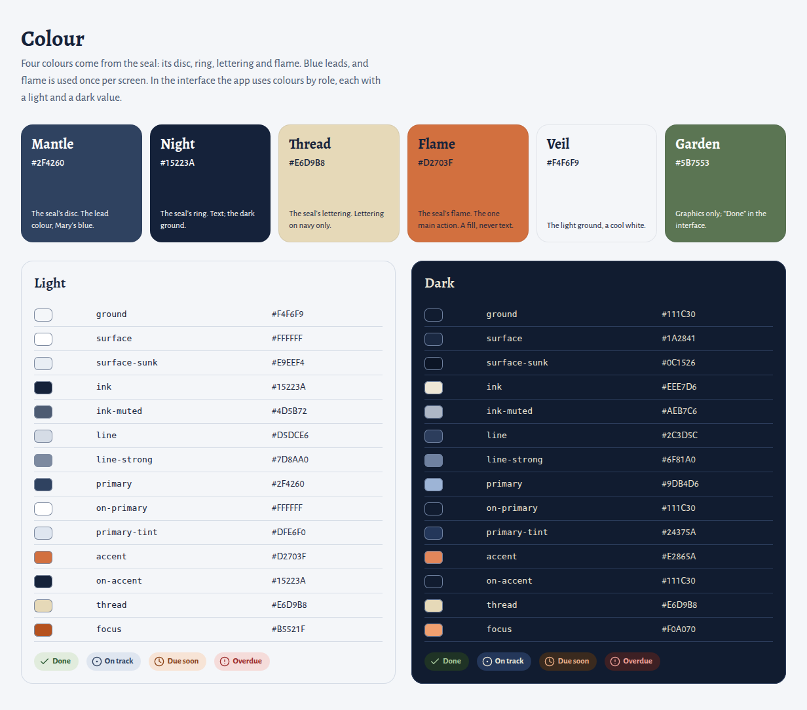
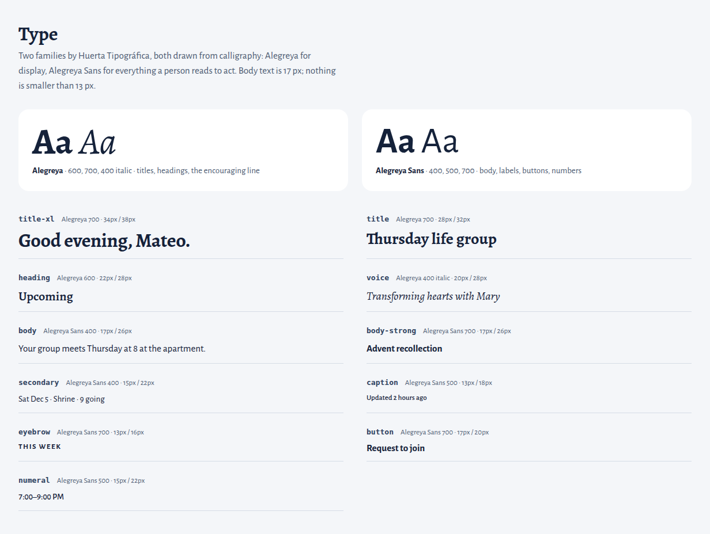
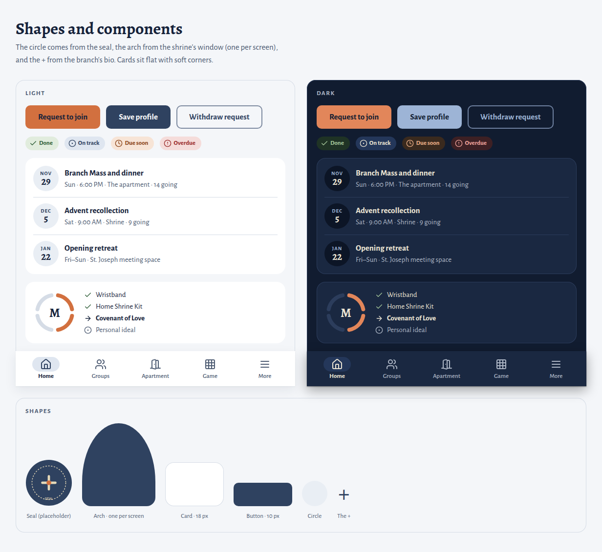
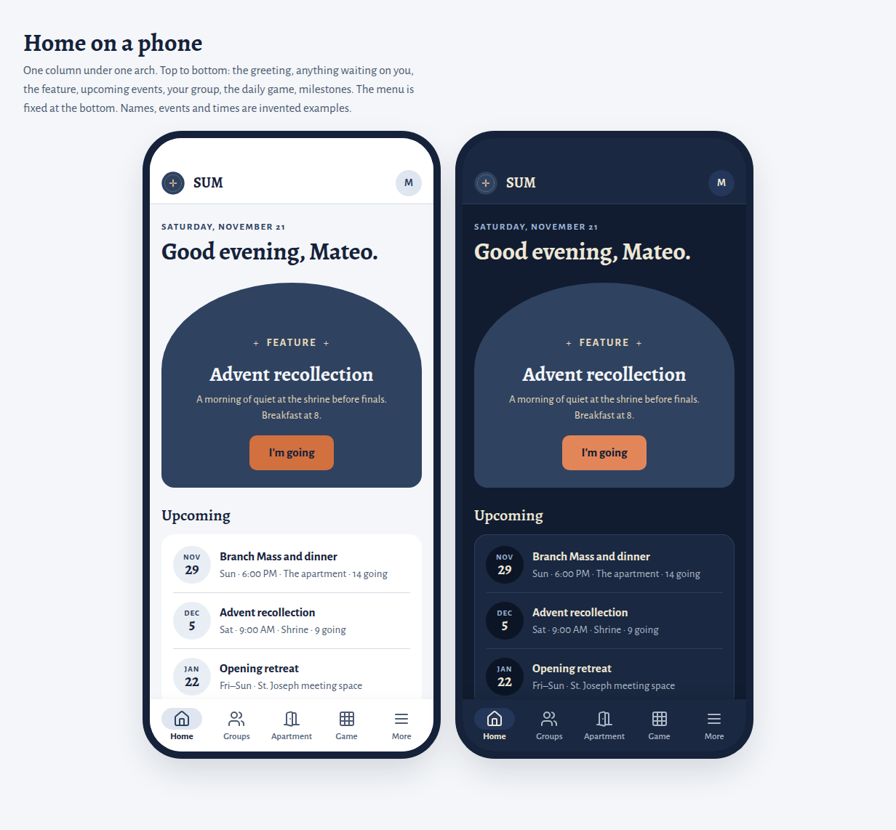

# 10 — Design

How the app looks and speaks. Proposed 2026-11-21, for the branch to agree.

**To see it rather than read it:** the images in this document come from one
page, [`design/brand.html`](design/brand.html). Download it and open it in a
browser to see the components live. In its pictures the seal is a
placeholder, because the original artwork isn't in this public repository
(see Open questions).

The same brand is also kept as a browsable design system, for agents to
build from:
[SUM Brand](https://claude.ai/artifact/Vb32AUQUG4UiXryt6NRdpi) (private).
This document is the source. Where the page, the images or the design system
differ from it, this document wins and the others are brought into line.

## Where SUM's brand sits

SUM belongs to the Schoenstatt movement and is administered by the
Schoenstatt Fathers. The app carries **SUM's own identity**, built on the
seal the branch already uses on Instagram. It does not borrow the Fathers'
logo or palette (those belong to the Fathers, whose manual governs them; see
[stewards' `design.md`](https://github.com/jroedel/stewards/blob/main/design.md)).
The About page says in words that SUM is administered by the Schoenstatt
Fathers. A joint piece uses the Fathers' monochrome version for
collaborations, as their manual provides.

The tagline is the branch's own, from its Instagram bio and the wristband:
**+ Transforming Hearts with Mary +**.

## Five words

The branch chose five words. Each is turned into something a designer can
check.

| Word | In the design |
|---|---|
| **Organic** | Soft shapes: rounded cards, circles after the seal, no hard corners or hard shadows. Real photographs of the branch, never stock. A typeface drawn from calligraphy, not geometry. |
| **Free** | Room to breathe: one column, generous space between sections, one idea per card. The interface invites and never pushes; a newcomer chooses his own life group. |
| **Marian** | Mary's blue leads, over a veil-white ground. The arch recalls the shrine's window. The star stays in the seal. |
| **Aspirational** | The arch points up; the greeting is set large; milestones show how far a man has come. Progress is shown, never scolded. |
| **Encouraging** | The voice congratulates real steps and names the next one. Status colours describe; only *Overdue* is red, and it says what to do. |

## The seal

The seal is the only mark: a navy disc with SCHOENSTATT UNIVERSITY MEN
around the edge, and at its centre the cross with a star and a flame.

**We only have it as a screenshot.** The original artwork (SVG, PDF or AI)
is needed before anything is printed or installed on a phone. Nobody traces
or redraws the seal.

- **Three colourways, no others:**
  1. *Full colour:* mantle disc, thread lettering and cross, flame in the
     flame. The everyday seal: the app header, the splash, the icon.
  2. *Cream on night:* thread on night. Dark grounds and the dark theme.
  3. *One colour:* night on white. Documents, stamps, one-colour print.

  The black-and-white and blue-on-black versions in the Instagram
  highlights would be retired in favour of these.
- **Clear space:** one eighth of the seal's diameter on every side.
- **Minimum size:** 96 px (25 mm) across with the lettering. Below that the
  lettering can't be read.
- **Never** recolour outside the three colourways, stretch, rotate, outline,
  add a shadow, set words inside the disc, or put the full-colour seal on a
  busy photograph.

**The seal and this public repository.** The repository is MIT-licensed.
Committing the seal's file here would look like an offer to license it under
MIT, which it isn't. When the artwork arrives, either it stays out of the
repository and reaches the server another way, or it goes in with a line in
`LICENSE` and `README.md` saying the seal and the name are not covered. See
Open questions.

## Colour

Six brand colours. Four come from the seal: the disc, its ring, its
lettering, and the orange flame of its colourway in the story highlights. A
ground and a green complete the set.

| Name | Hex | From | Use |
|---|---|---|---|
| **Mantle** | `#2F4260` | the seal's disc | The first colour. The seal, the icon, the primary button, links, the active tab |
| **Night** | `#15223A` | the seal's ring | Text in the light theme; the ground in the dark |
| **Thread** | `#E6D9B8` | the seal's lettering | Lettering on mantle or night; eyebrow labels on mantle; the `+` ornament. **Never text on a light ground** |
| **Flame** | `#D2703F` | the seal's flame | The one main action on a screen; filled milestone arcs; the game's streak. **A fill, never text** |
| **Veil** | `#F4F6F9` | (chosen) | The light ground: a cool white with a trace of blue |
| **Garden** | `#5B7553` | (chosen) | Graphics only. In the interface it appears as *Done* |

**In the interface the app uses names for roles, not for colours**, so that
each one follows the light or dark theme.

| Token | Light | Dark | Role |
|---|---|---|---|
| `ground` | `#F4F6F9` | `#111C30` | Behind everything |
| `surface` | `#FFFFFF` | `#1A2841` | Cards, sheets, the top bar and the tab bar |
| `surface-sunk` | `#E9EEF4` | `#0C1526` | Wells inside a card: an event's date disc |
| `ink` | `#15223A` | `#EEE7D6` | Body text and headings |
| `ink-muted` | `#4D5B72` | `#AEB7C6` | Metadata and captions |
| `line` | `#D5DCE6` | `#2C3D5C` | Hairlines that only separate |
| `line-strong` | `#7D8AA0` | `#6F81A0` | Borders that mean something: inputs, the quiet button |
| `primary` | `#2F4260` | `#9DB4D6` | Buttons, links, the active tab |
| `on-primary` | `#FFFFFF` | `#111C30` | Text on `primary` |
| `primary-tint` | `#DFE6F0` | `#24375A` | The active tab's pill, a selected row, *On track* |
| `accent` | `#D2703F` | `#E2865A` | The one main action |
| `on-accent` | `#15223A` | `#111C30` | Text on `accent`: night, never white |
| `thread` | `#E6D9B8` | `#E6D9B8` | Eyebrows and ornaments on mantle |
| `focus` | `#B5521F` | `#F0A070` | The focus ring |

**Rules over them:**

- **Lead with blue.** A screen is ground and surface, ink text, primary for
  what can be pressed, and at most one accent. Two flame-coloured things on
  one screen means one of them is wrong.
- **Thread and flame are never text on a light ground** (thread would be
  1.3:1, flame 3.2:1). On a flame fill, the text is night (4.6:1), never
  white (3.4:1).

### Status

A checklist step ([09](09-checklists-and-milestones.md)) has four states.
Each always shows **an icon and a word**, because about one man in twelve
can't tell this green from this orange.

| State | Icon | Text / fill, light | Text / fill, dark |
|---|---|---|---|
| Done | check | `#2F5E37` on `#E1ECDD` | `#A5C79B` on `#1F3325` |
| On track | dot | `primary` on `primary-tint` | `ink` on `primary-tint` |
| Due soon | clock | `#8A4316` on `#F7E4D6` | `#EDB088` on `#3A2A1E` |
| Overdue | alert | `#9B2C2C` on `#F5DCDA` | `#F0A39C` on `#3D2024` |

### Contrast, measured

| Pair | Light | Dark |
|---|---|---|
| `ink` on `ground` | 14.7:1 | 13.8:1 |
| `ink` on `surface` | 16:1 | 12.0:1 |
| `ink-muted` on `ground` | 6.4:1 | 8.4:1 |
| `primary` on `ground` | 9.4:1 | 8.1:1 |
| `on-primary` on `primary` | 10.2:1 | 8.1:1 |
| `on-accent` on `accent` | 4.6:1 | 6.3:1 |
| `line-strong` on `ground` | 3.2:1 | 4.3:1 |
| `focus` on `ground`, `surface`, `primary-tint` | 4.0:1 or better | 5.6:1 or better |
| Thread on mantle | 7.2:1 | 7.2:1 |
| Status text on its fill | 5.8:1 or better | 7.2:1 or better |

## Type

Two families by Huerta Tipográfica, made to go together: **Alegreya** for
display and **Alegreya Sans** for everything a person reads to act. Both are
calligraphic in origin, warm without being quaint, and free under the SIL
Open Font License. The seal's lettering is the seal's own; the brand doesn't
try to imitate it.

| Style | Face | Size / line | Use |
|---|---|---|---|
| `title-xl` | Alegreya 700 | 34 / 38 px | Home's greeting. Once per screen at most |
| `title` | Alegreya 700 | 28 / 32 px | Screen titles |
| `heading` | Alegreya 600 | 22 / 28 px | Sections |
| `voice` | Alegreya 400 italic | 20 / 28 px | The encouraging line: the tagline, a milestone reached, a line from the founding documents. Once per screen |
| `body` | Alegreya Sans 400 | **17** / 26 px | Running text and rows |
| `body-strong` | Alegreya Sans 700 | 17 / 26 px | A row's title |
| `secondary` | Alegreya Sans 400 | 15 / 22 px | Metadata, in `ink-muted` |
| `caption` | Alegreya Sans 500 | 13 / 18 px | The smallest text there is |
| `eyebrow` | Alegreya Sans 700, capitals, +0.12em | 13 / 16 px | A label over a heading, after the seal's spaced capitals |
| `button` | Alegreya Sans 700 | 17 / 20 px | Buttons |
| `numeral` | Alegreya Sans 500, lining tabular figures | 15 / 22 px | Times and amounts in columns. Alegreya's default figures are old-style, so this is set explicitly |

**The app serves the fonts itself.** Five woff2 files, subset to Latin:
Alegreya 600, 700 and 400 italic, Alegreya Sans 400 and 700 (about 150 KB in
all). They have hashed names and are cached by the service worker, so a phone
downloads them once. The app never loads Google Fonts at run time. That would
add a second connection on every cold start ([02](02-architecture.md),
"Latency"). And the server is in Germany, where a court has held that
embedding Google Fonts breaches a visitor's privacy.

## Shape

- **The circle**, from the seal: avatars, an event's date disc, the
  milestone ring, chips.
- **The arch**, from the shrine's window: **one per screen**, on the feature
  card or a photo. It is half the card's width across, rises 120 px, and has
  18 px corners at the foot.
- **The `+`**, from the branch's bio: it flanks the tagline and marks the
  feature. It is never a bullet in an ordinary list.
- **Radii:** 10 px on buttons and inputs, 18 px on cards, round on chips.
- **Spacing:** steps of 4, 8, 12, 16, 24, 32 and 48 px. The side gutter on a
  phone is 16 px plus the safe-area inset.
- Cards are flat on the ground: no border in the light theme, a hairline in
  the dark. Only the tab bar and floating sheets have a shadow.

## The app's layout

One column, mobile first, under one arch.

- **Top bar** (56 px, on `surface`): the full-colour seal at 32 px, then
  either "SUM" or the screen's title, then the person's avatar at the right.
  At 32 px the seal is decoration, so it has no alt text; the name beside it
  is the label.
- **The menu** is fixed in code ([07](07-pages-and-menu.md)). On a phone it
  is a tab bar at the bottom: 64 px plus the home-indicator inset. Members see
  **Home, Groups, Apartment, Game, More**. A newcomer sees **Home, Groups,
  Game, More**. *More* holds the pages, dues, the profile and, for the
  secretary and priest moderators, their tools. The active tab is its icon
  and label on a `primary-tint` pill. A new feature goes under *More*; there
  is never a sixth tab.
- **From 960 px wide**, the column stays at most 36 rem (about 600 px) and
  centred, and the tab bar becomes a left rail with the seal at its head.
- **Home**, top to bottom:
  1. the date as an eyebrow, and the greeting;
  2. *Waiting on you*, only when something is (each role's items are in
     [07](07-pages-and-menu.md));
  3. the feature, in the screen's one arch;
  4. *Upcoming*: events as rows with date discs;
  5. *Your group*: the meeting day, time and place;
  6. the daily game's tile and streak;
  7. the milestone ring.

  A section with nothing in it is left out, not shown empty.
- **One main action per screen**, in `accent`, low on the screen where a
  thumb reaches. Every target is at least 48 px. Nothing depends on hover.

### Components

The design system has a live preview of each. These are the ones the MVP
needs:

| Component | What it is |
|---|---|
| Button | Accent (once per screen), primary, quiet. Verb-first sentence-case labels |
| Status chip | The four states above, icon and word |
| Event row | Date disc, title, one line of metadata (day, time, place, how many are going) |
| Tab bar | The fixed menu |
| Milestone ring | The four personal milestones ([09](09-checklists-and-milestones.md)) as four arcs around the man's initial: wristband, Home Shrine Kit, Covenant of Love, personal ideal. Done arcs are flame. A list beside it marks each done step with a check and the next with an arrow, so the ring reads without colour |
| App shell | Top bar, column, tab bar |

## Icons

[Lucide](https://lucide.dev) (ISC license): a 24 px grid, 2 px stroke, round
caps and joins. The app serves one SVG sprite holding only the icons it
uses. One family throughout, and no emoji in the interface. The cross, star
and flame appear only in the seal; they are never icons.

## Imagery

- **The branch's own photographs**: retreats, the shrine, overnights, branch
  day. Never stock photographs of students.
- A photo of members is shown only inside the app, and only with their
  agreement. None goes on a public page without it.
- A feature photo takes the arch. Photos aren't tinted, except a deliberate
  mantle duotone behind lettering on the splash and on shared posts.

## Voice

The app speaks as the branch, *we*, to one man, *you*: plain, warm and
short.

- **Congratulate real steps, then name the next.** One exclamation mark is
  allowed, for a milestone; none anywhere else.
- **Invite, never pressure.** Write "Find a life group", not "You haven't
  joined a group". Write "Dues for Spring 2027 are open", not "You owe $60".
- **Say what to do.** An overdue step names the step and who can help.
- **Use the branch's words:** life group, overnight, branch day, the
  apartment, Covenant of Love, Home Shrine. Write *Schoenstatt University
  Men* in full the first time on a page, then *SUM*.
- **Sentence case** for titles, buttons and tabs. Capitals only in
  eyebrows.
- **Mary is named with reverence and without decoration:** "Mother Thrice
  Admirable" or "Our Lady" in devotional text, never as a slogan on a
  button.

| Where | Copy |
|---|---|
| Home greeting | Good evening, Mateo. |
| A newcomer's Home | Welcome to SUM. Start by finding a life group: here are the open ones. |
| Request sent | Request sent to the Thursday group. Their mentors will answer soon. |
| Milestone reached | Home Shrine Kit received. Your shrine has a home! |
| A step due soon | Choose next semester's meeting day. Due Friday. |
| An overdue step | Overnight not scheduled yet. Talk to your mentor this week. |
| Empty | Nothing on the apartment schedule this week. |
| Sign-in email | Your SUM sign-in code is 482 913. It works for 10 minutes. If you didn't ask for it, ignore this email. |

(Names and groups in examples are invented.)

## The installed app

What `manifest.json` carries:

- `name` and `short_name`: **SUM**, so the name under the icon is short;
- `display`: `standalone`;
- `theme_color`: `#2F4260` (mantle);
- `background_color`: `#15223A` (night).

The icon is the full-colour seal on a mantle square, kept inside the central
80% so a round mask doesn't cut the lettering. It comes at 192 and 512 px,
plus a 180 px `apple-touch-icon`. The splash is night, with the seal and the
tagline in thread.

## Accessibility

- Text meets 4.5:1 on its ground in both themes (the table above).
- The focus ring is 2 px solid `focus` with a 2 px offset, on every
  interactive element.
- Light and dark follow the phone's setting. The dark theme is designed in
  its own right: a night ground, cream text, and a lighter mantle for
  `primary`.
- Targets are 48 px or more. Motion is limited to short fades and a
  milestone arc filling, and none of it plays when the phone asks for
  reduced motion.

## Language

English only, or English and Spanish: still open.

## Open questions

- **The seal's original artwork** (SVG, PDF or AI), and who holds it.
- **The seal in this public repository:** keep the file out, or commit it
  with a note that it isn't under the MIT license.
- **A small mark** for the favicon and for icons below 96 px, where the
  lettering can't be read. The proposal is the cross with the star and
  flame alone, cut from the original artwork. The branch decides whether
  that may stand for the seal.
- **Retiring the other colourways** seen in the Instagram highlights
  (black-and-white, blue on black).
- **Who in the branch signs off** on the brand, and whether Instagram and
  printed material follow it too or it stays the app's.
- Whether the tagline is written "Transforming Hearts with Mary" (title
  case, as on Instagram) or "Transforming hearts with Mary".
- Language.
